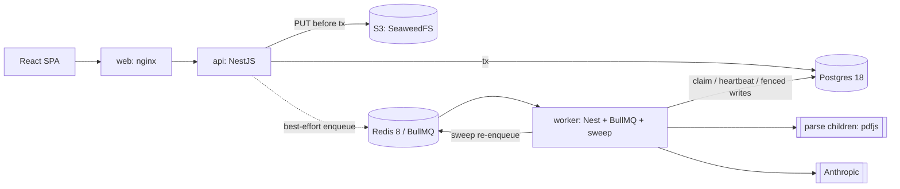

# Architecture

A summary of how the system fits together. The detailed and authoritative version is §2–3 of the
[design spec](../superpowers/specs/2026-11-27-document-review-design.md).

## Who owns what
| Store | Holds | If it's lost |
|---|---|---|
| **Postgres** | Documents, versions (status, lease, parsed text), runs, every LLM call, values, reviews, idempotency keys | It is the system of record and must be backed up |
| **Redis** | "Work on version X soon" jobs | Rebuilt from Postgres by the sweep in ≤ 10s ([ADR-0001](../adr/0001-postgres-version-status-is-the-outbox.md)) |
| **S3** | Immutable PDF bytes, content-addressed | Needed only for the first parse and downloads; evidence uses the stored parsed text |

## Lifecycle of one upload
1. The API validates the PDF, PUTs it to S3, then commits the document and version as `queued`, then tries to enqueue. It returns 201 without waiting on the LLM.
2. The worker claims the version and takes out a fenced lease.
3. The worker parses the PDF in a child process, and checkpoints the parsed text.
4. The worker calls the LLM and checkpoints the raw response **before** validating it.
5. The worker validates the evidence and finalizes under the document lock. Carry-over (rule A′) runs here, and the reviewable pointer moves.
6. The reviewer approves, corrects or reverts. Reviews are append-only.

Failures are states: `failed` plus a code, always retryable by a human. Crashes, zombie workers,
Redis flushes and concurrent new versions are handled by the fencing token, the sweep and the
document-row lock. See the failure matrix in the spec, §2.
