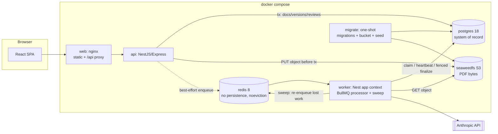
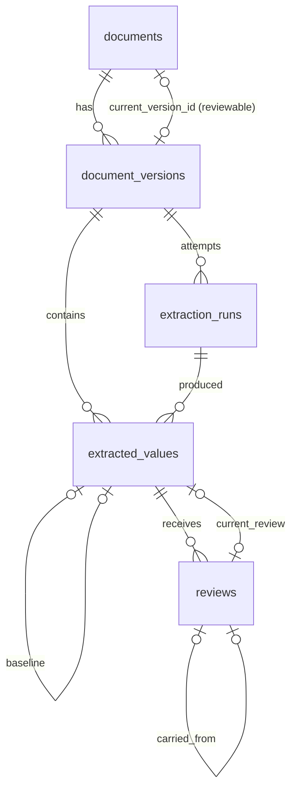
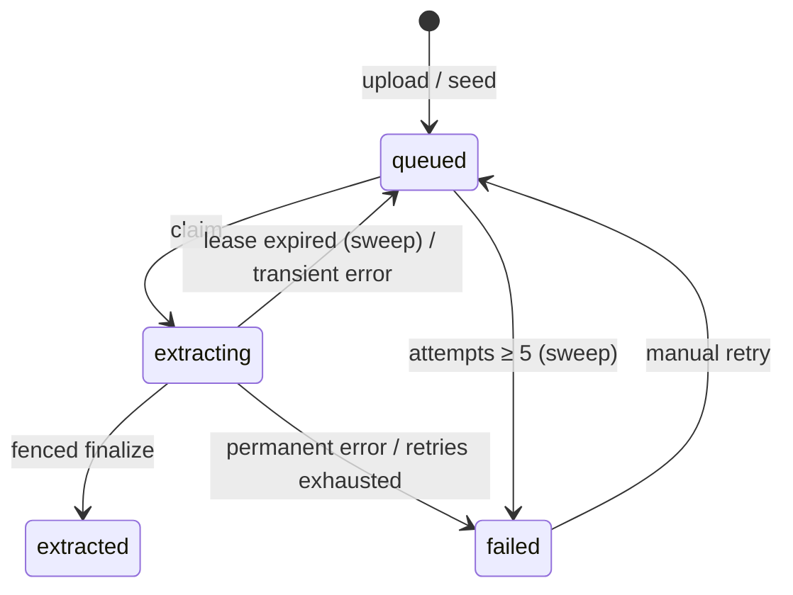

# Lomi Labs Take-Home — Engineering Plan v1

> Supersedes PLAN-v0. Produced by attacking v0 against the brief, `jd.md` and the actual
> `fixtures/`, then a three-round debate (Pragmatic Shipper / Reliability Purist /
> Hiring-Signal Strategist) with final calls made by the owner.
>
> Deadline: **Sat 28 Nov 2026 23:59 UTC**.

---

## 0. What the fixtures force on the design

Invoice v1 → v2 (parsed with `pdftotext`):

| Field | v1 | v2 | Required outcome |
|---|---|---|---|
| invoice_number | `INV-2025-0847` | same | carried over |
| issue_date | `2025-09-14` | same | carried over |
| **due_date** | `2025-10-14` | **`2025-11-13`** | pending, show previous |
| vendor_name | `MERIDIAN OFFICE SUPPLIES LLC` | same | carried over |
| **total_amount** | `$5,230.29` | **`$6,126.45`** | pending, show previous |

Traps that shape the design:

1. **v2 inserts a paragraph** ("This revised invoice supersedes the version issued on
   2025-09-14 …"). Offsets shift, so anything based on offsets or a whole-document hash breaks.
2. **`2025-09-14` appears twice in v2.** A bare-date quote is ambiguous. Carry-over must not
   depend on which occurrence the LLM quoted.
3. **Non-field noise changes:** the header becomes `INVOICE (REVISED)`, `Net 30` becomes
   `Net 60`, and line items and subtotal change. None of these may trigger a re-review.
4. **Raw text layout differs from the visual layout.** Table cells land on separate lines
   (`Total Due:\n$5,230.29`), so verbatim matching must normalize whitespace.
5. **market_report.median_household_income is absent** from the document: a planted gap test.
   There are also distractors: 4.2% vs 4.9% prior quarter, 1BR $1,985 vs 2BR $2,540, YoY 3.8%
   vs "moderating toward 3%".
6. **Lease:** `lease_start` reads "March 1, 2025" but the value is ISO `2025-03-01`.
   `term_months` reads "twenty-four (24)" but the value is `24`. The value is not a substring
   of the evidence.
7. **Field types** are string, date, money, number and percent. They drive value
   normalization, correction validation, equality for carry-over, and UI inputs.
8. **Manifest ids are slugs** (`doc-invoice-001`), so the seed must be idempotent on them.

Acceptance test derived from this: **uploading invoice v2 leaves exactly {due_date,
total_amount} pending, and the other three are carried over.**

---

## 1. Decision log

| # | Decision | Chosen | Rejected and why |
|---|---|---|---|
| D1 | Durable job intent | **Version row `status='queued'` is the outbox**, plus a reconciler sweep in the worker | A separate `outbox_events` table plus dispatcher duplicates the same fact. Its "delivered" flag is a lie after `FLUSHALL`, so the sweep is needed anyway. This is the brief's "tempting option". |
| D2 | New version while previous is extracting | **Accept. Extractions run concurrently; carry-over is serialized** under a `documents` row lock at finalize | *Reject (409)* fails "we will try it". *Strict queue* needs BullMQ Pro groups or hand-rolled delays for no benefit, since extraction only reads its own text. *Supersede/cancel* adds zombie risk and loses work. |
| D3 | Which version is reviewable | **Only `documents.current_version_id` = latest extracted.** The review tx takes `FOR SHARE` on the doc row; finalize takes `FOR UPDATE` | "Lock once a newer version is uploaded" would lock v1 forever if v2 fails. |
| D4 | Carry-over rule | **Carry iff the baseline has a current review AND the normalized values are equal AND the baseline's canonical evidence line(s) occur in the new version's normalized text** | A fingerprint of the raw LLM quote is nondeterministic: a different span means a false re-review. "Ambiguous quote means never carry" sends issue_date back (trap 2). |
| D5 | Evidence matching | **NFC plus whitespace-collapse only**, expanded to canonical full line(s) | Quote, case or hyphen folding would accept more hallucinations. |
| D6 | Value vs evidence mismatch | **Gap** (`VALUE_NOT_SUPPORTED`) | A soft flag keeps a possible hallucination, and the brief says "never kept". |
| D7 | Correction model | **Annotation**: the extracted value is immutable; the review holds `corrected_value`; effective = corrected ?? extracted | Replace destroys provenance and breaks the "previous value and review" display. |
| D8 | Review history | **Append-only `reviews`** plus a `extracted_values.current_review_id` projection updated in the same tx | Event sourcing is overkill. Mutable reviews lose history. |
| D9 | Gaps | **Reviewable.** Approve means "confirmed not present"; correct means "enter value". **Gaps never carry over** (no evidence to compare) | Hiding gaps from review conflicts with "a human reviews every value". |
| D10 | Progress buckets | **Disjoint, summing to the total**: pending / approved / corrected / carried_over (carried items also expose their original decision) | Overlapping counts confuse the "five seconds" read. |
| D11 | Claim / lease / fencing | Conditional `UPDATE … RETURNING` claim. **`active_run_id` is the fencing token.** Lease 30s, heartbeat 10s, sweep 10s, attempts cap 5 | DB advisory locks or a separate heartbeats table: the version row is already the lock. |
| D12 | Retry ownership | **BullMQ: in-run transient retries** (3 attempts, exponential backoff, only 429/5xx/timeout/storage). **DB: cross-crash recovery** (lease plus sweep). Manual retry endpoint for `failed` | Relying on BullMQ retries alone: they die with `FLUSHALL`. |
| D13 | Job ids and dedupe | `jobId = versionId`. **`removeOnComplete: true, removeOnFail: true`.** The sweep removes a finished job with that id before re-adding | Retained failed jobs silently dedupe a re-add, leaving the version stuck in `queued` forever (bug found in round 2). |
| D14 | Files | **S3 API via `@aws-sdk/client-s3`.** Compose: **SeaweedFS**. CI: **AWS Emulator**. Content-addressed keys; PUT the object before the DB tx; download proxied through the API | `bytea` (owner prefers object storage). MinIO is archived. LocalStack needs an auth token. AWS Emulator is in-memory only, so a restart would lose PDFs (fine for CI, wrong for compose). |
| D15 | Parsed text | **Stored per version in Postgres** with sha256 and parser version | Re-parsing on demand risks parser drift invalidating historical evidence. |
| D16 | LLM | **Provider-agnostic `LlmProvider` interface** in `packages/llm`. Anthropic `claude-sonnet-5-5` default (env `LLM_MODEL`; Haiku documented as the cheap option), forced tool use, temperature 0. A fake provider for tests. Gemini and Ollama are future adapters | Vercel AI SDK abstracts away the raw response we must store. Haiku as default risks the distractors; cost is under a cent per document anyway. |
| D17 | No API key | Run claims, then fails `LLM_NOT_CONFIGURED`: visible and retryable after the key is set | A fake provider at runtime: the brief says the LLM is not optional. |
| D18 | API framework | **NestJS 11 on the Express adapter** for the API **and** the worker (standalone app context). **Nest is wiring only**; reliability logic lives in framework-free packages | Plain Fastify (A): fewer layers, but more hand-wired lifecycle, config and health. Nest on the Fastify adapter: multipart friction. |
| D19 | DB access | **Drizzle ORM + drizzle-kit, generated migrations only, zero hand edits** | Prisma: CHECK constraints and partial indexes need hand-edited migrations, and the claim/fence path needs `$queryRaw`. |
| D20 | Contracts | **zod v4 in `packages/contracts`**, used by the API (nestjs-zod) and web. Swagger at `/docs` | tRPC hides the REST surface the brief specifies. ts-rest adds another DSL. |
| D21 | Frontend | **Vite + React SPA**, TanStack Query, React Router, Tailwind plus a few copied shadcn components. Served by **nginx**, which proxies `/api` | Next.js: SSR/RSC buys nothing for an internal tool and adds a second server. |
| D22 | Live updates | **Polling** with `refetchInterval` 2s only while any visible version is `queued`/`extracting` | SSE/WebSockets: status flips about twice per document, so this is the "tempting" option. |
| D23 | PDF parsing | **`unpdf`** (pdfjs), pinned version, parser version stored per version | The poppler binary adds a system dependency. `pdf-parse` is stale. |
| D24 | Internal packages | **Compiled `tsc -b` → `dist` with `.d.ts`**, so `^build` is real and cached | JIT/source packages make package builds no-ops, which looks decorative. |
| D25 | Lint / format | **ESLint flat config + typescript-eslint (type-aware `no-floating-promises`) + Prettier**, plus `no-restricted-imports` boundaries | Biome has weaker boundary and type-aware rules. |
| D26 | Runtime / images | **Node 24 LTS**, `node:24-slim`, pnpm 10, Turborepo 2 | Bun (ecosystem edges), alpine (musl surprises). |
| D27 | Tests | Vitest. Integration tests against real PG/Redis/S3 (compose locally, GH Actions services plus AWS Emulator in CI). **Automated chaos test in CI** | Testcontainers adds wiring time for no extra coverage. |
| D28 | Seed | Migrate container: run migrations → ensure bucket → PUT fixture PDFs → upsert docs/versions as **`queued` only**; the worker's boot sweep enqueues them | Seed calling `queue.add` adds a second enqueue path and makes migrate depend on Redis. |
| D29 | Deployment | **Cut.** README section "how I'd ship it" (Cloud Run api/web, worker with min-instances=1, Cloud SQL, Memorystore, GCS, Secret Manager, Terraform modules) | A live deploy costs about half a day plus always-on cost, and a broken link is worse than none. |

---

## 2. Architecture



**The line between Postgres and Redis:**

- **Postgres** holds everything that must survive: documents, versions (status, lease, attempts,
  parsed text), runs (prompt, raw response, usage, error), values, reviews.
- **Redis** holds only "please work on version X soon". All of it can be rebuilt from
  `document_versions` by the sweep. Redis runs with `--save "" --appendonly no` to prove it is
  disposable, and with `--maxmemory-policy noeviction` because BullMQ requires it.
- **S3** holds immutable PDF bytes under content-addressed keys. It is only needed for the first
  parse and for download. Evidence checks and review use the parsed text in Postgres.

### Failure matrix

| Failure | What happens | Guarantee |
|---|---|---|
| Redis down during upload | Version committed `queued`. Enqueue fails fast (producer connection uses `enableOfflineQueue:false` plus a 500ms timeout). Upload still returns 201 | Sweep enqueues once Redis is back |
| `FLUSHALL` | All jobs lost | Sweep re-adds `queued` versions and expired-lease `extracting` versions within about 10s |
| Worker killed mid-LLM | Lease expires within 30s or less | Sweep resets the version to `queued` (old run marked `abandoned`, fenced) and re-enqueues. On boot, the worker releases leases held under its own `worker_id` immediately |
| Zombie worker returns after lease expiry | Heartbeat or finalize `WHERE active_run_id=$me` matches 0 rows | Aborts with no write |
| Crash after finalize commit, before ack | Redelivery, claim finds `status='extracted'` | No-op ack, no duplicate values (plus `UNIQUE(version_id, field_key)`) |
| Duplicate enqueue / impatient retry | jobId dedupe plus conditional claim | One run |
| LLM 429/5xx/timeout | BullMQ backoff retry (3) | Then `failed`, retryable |
| Parse error, schema-invalid LLM output, missing key | `UnrecoverableError` | Immediately `failed` with code, retryable |
| S3 down at upload | 503 `STORAGE_UNAVAILABLE`, nothing committed | Client retries; nothing is half-written |
| S3 down during extraction | Transient retry, then `failed` | Retryable |
| Crash loop on one version | attempts ≥ 5 | Sweep marks `failed` with `MAX_ATTEMPTS` and stops looping |
| `docker compose restart` | Combination of the above | Every version ends `extracted` or visibly `failed`, never stuck |

---

## 3. Database schema (Drizzle, generated migrations only)

Conventions: `uuid` PKs with `defaultRandom()`, `timestamptz` with `defaultNow()`, `updated_at`
set via `$onUpdate`. Statuses are **`text` + CHECK** (not `pgEnum`, so enum churn never forces a
hand edit). **No triggers, no functions.** FKs use `ON DELETE RESTRICT` because nothing is ever
deleted.

### `documents`
| column | type | notes |
|---|---|---|
| id | uuid PK | |
| external_id | text UNIQUE NULL | manifest slug (`doc-invoice-001`); seed upsert key |
| type | text NOT NULL | CHECK in (`invoice`,`lease`,`market_report`) |
| title | text NOT NULL | upload defaults to the filename |
| latest_version_number | int NOT NULL default 0 | allocation counter |
| current_version_id | uuid NULL FK → document_versions | **reviewable = latest extracted**; set only by finalize |
| created_at, updated_at | timestamptz | |

Version allocation is atomic and row-locking:
`UPDATE documents SET latest_version_number = latest_version_number + 1 WHERE id=$1 RETURNING latest_version_number`.

### `document_versions`
| column | type | notes |
|---|---|---|
| id | uuid PK | also the BullMQ jobId |
| document_id | uuid FK | |
| version_number | int NOT NULL | UNIQUE(document_id, version_number) |
| status | text NOT NULL | CHECK in (`queued`,`extracting`,`extracted`,`failed`) |
| storage_key | text NOT NULL | `pdfs/sha256/<hex>.pdf` |
| file_sha256 | text NOT NULL | verified on read |
| file_size_bytes | int NOT NULL | |
| original_filename | text NOT NULL | |
| parsed_text | text NULL | set on first successful parse |
| parsed_text_sha256 | text NULL | |
| parser | text NULL | e.g. `unpdf@1.x` |
| attempts | int NOT NULL default 0 | incremented by claim |
| active_run_id | uuid NULL FK → extraction_runs | **fencing token** |
| lease_until | timestamptz NULL | |
| worker_id | text NULL | fast lease release on worker boot |
| enqueued_at | timestamptz NULL | sweep grace window |
| last_error_code | text NULL | `LLM_NOT_CONFIGURED`, `PARSE_FAILED`, `LLM_SCHEMA_INVALID`, `STORAGE_UNAVAILABLE`, `INTEGRITY_MISMATCH`, `MAX_ATTEMPTS`, … |
| last_error_message | text NULL | |
| extracted_at | timestamptz NULL | |
| created_at, updated_at | timestamptz | |

CHECKs:
- `(status = 'extracting') = (active_run_id IS NOT NULL AND lease_until IS NOT NULL)`
- `status <> 'extracted' OR parsed_text IS NOT NULL`

Partial index: `(status, lease_until) WHERE status IN ('queued','extracting')`, used by the sweep.

### `extraction_runs` (one row per attempt; debuggability)
| column | type | notes |
|---|---|---|
| id | uuid PK | = run id = fencing token |
| version_id | uuid FK | UNIQUE(version_id, attempt) |
| attempt | int NOT NULL | |
| status | text NOT NULL | CHECK in (`running`,`succeeded`,`failed`,`abandoned`) |
| worker_id | text NOT NULL | |
| provider, model, prompt_version | text NULL | |
| request | jsonb NULL | system prompt, user prompt, tool schema |
| raw_response | jsonb NULL | provider response verbatim |
| usage | jsonb NULL | input/output tokens |
| cost_usd | numeric(10,6) NULL | |
| latency_ms | int NULL | |
| error_code, error_message | text NULL | |
| started_at, heartbeat_at, finished_at | timestamptz | |

### `extracted_values`
| column | type | notes |
|---|---|---|
| id | uuid PK | |
| version_id | uuid FK | UNIQUE(version_id, field_key): the idempotency backstop |
| run_id | uuid FK → extraction_runs | provenance |
| field_key | text NOT NULL | |
| field_type | text NOT NULL | CHECK in (`string`,`date`,`money`,`number`,`percent`) |
| kind | text NOT NULL | CHECK in (`value`,`gap`) |
| value | jsonb NULL | canonical typed value (see §4.4) |
| raw_value | text NULL | the LLM's string, for audit |
| evidence | text NULL | the LLM's quote as given |
| canonical_evidence | text NULL | normalized full line(s) containing the match |
| evidence_start, evidence_end | int NULL | offsets into `parsed_text` (highlighting) |
| evidence_match_count | int NULL | |
| gap_code | text NULL | CHECK in (`NOT_FOUND`,`MODEL_OMITTED`,`EVIDENCE_NOT_IN_TEXT`,`VALUE_NOT_SUPPORTED`,`UNPARSEABLE_VALUE`) |
| gap_reason | text NULL | human-readable |
| baseline_value_id | uuid NULL FK → extracted_values | the same field in the baseline version (diff display) |
| change_kind | text NOT NULL | CHECK in (`new`,`same`,`changed`) relative to the baseline |
| current_review_id | uuid NULL FK → reviews | projection |
| created_at | timestamptz | |

CHECK (the gap invariant):
`(kind='value' AND value IS NOT NULL AND evidence IS NOT NULL AND gap_code IS NULL) OR (kind='gap' AND value IS NULL AND gap_code IS NOT NULL AND gap_reason IS NOT NULL)`

### `reviews` (append-only)
| column | type | notes |
|---|---|---|
| id | uuid PK | |
| value_id | uuid FK → extracted_values | |
| decision | text NOT NULL | CHECK in (`approve`,`correct`) |
| corrected_value | jsonb NULL | CHECK `(decision='correct') = (corrected_value IS NOT NULL)` |
| note | text NULL | |
| origin | text NOT NULL | CHECK in (`human`,`carried`) |
| carried_from_review_id | uuid NULL FK → reviews | CHECK `(origin='carried') = (carried_from_review_id IS NOT NULL)` |
| reviewer | text NOT NULL default `'reviewer'` | no auth (cut) |
| created_at | timestamptz | |

Index: `(value_id, created_at DESC)`. Append-only is enforced by the repository API (no update
or delete functions exist) plus a test. In production I would add `REVOKE UPDATE, DELETE`.

**Progress bucket** of a value, computed from its current review:
`null → pending`, `origin=carried → carried_over`, `approve → approved`, `correct → corrected`.



**Spike (first hour):** write the full Drizzle schema, run `drizzle-kit generate`, and read the
SQL. Confirm the CHECKs, partial index and circular FKs are emitted. If anything is missing,
redesign the schema rather than hand-edit. CI guard: `drizzle-kit generate` followed by
`git diff --exit-code packages/db/drizzle` fails on drift.

---

## 4. Core algorithms (`packages/core`, pure, no IO)

### 4.1 Normalization
`norm(s) = NFC(s) → replace [  -​ 　] with ' ' → collapse \s+ to ' ' → trim`.
Nothing else: no case, quote, dash or digit folding. Build `normText` plus an index map back to
`parsed_text` offsets.

### 4.2 Evidence validation (per field, in order)
1. Field missing from the LLM output → gap `MODEL_OMITTED`.
2. `found=false` or value null → gap `NOT_FOUND` (reason = the LLM's `not_found_reason`).
3. Evidence empty → gap `EVIDENCE_NOT_IN_TEXT`.
4. Find every occurrence of `norm(evidence)` in `normText`. 0 → gap `EVIDENCE_NOT_IN_TEXT`.
5. Parse `raw_value` per type (§4.4). Failure → gap `UNPARSEABLE_VALUE`.
6. For each occurrence, expand it to the **full original line(s)** it spans → `canonical_evidence`
   = norm(those lines). Choose the first occurrence whose quote or canonical line passes the
   **value check** (§4.3). If none passes → gap `VALUE_NOT_SUPPORTED`.
7. Store value, evidence, canonical_evidence, offsets of the chosen occurrence, match_count.

### 4.3 Value ↔ evidence check (type-aware)
- money: some money token in the text (`\$?\d{1,3}(,\d{3})*(\.\d+)?`) equals the amount.
- percent: some `\d+(\.\d+)?%` token equals the value.
- number: a digit token equals the value, or a spelled-out number does ("twenty-four (24)").
- date: an ISO, `Month D, YYYY`, or `MM/DD/YYYY` date token equals the value.
- string: case-insensitive normalized substring.

### 4.4 Canonical typed values (jsonb)
| type | canonical | example |
|---|---|---|
| string | `"..."` (norm) | `"MERIDIAN OFFICE SUPPLIES LLC"` |
| date | `"YYYY-MM-DD"` | `"2025-03-01"` |
| money | `{"amount":"5230.29","currency":"USD"}` (decimal string) | |
| number | `"24"` (decimal string) | |
| percent | `"4.2"` (decimal string, percent units) | |

Equality for carry-over = deep-equal on the canonical form. Corrections are validated with the
same per-type zod schema (422 on mismatch).

### 4.5 Carry-over (at finalize, inside the locked tx)
Baseline = the highest version with `status='extracted'` and `version_number < mine`. For each
field:
```
B = baseline value for field_key (may be absent)
change_kind = new       if B absent
            = same      if B.kind = N.kind = 'value'
                           AND equal(B.value, N.value)
                           AND B.canonical_evidence ⊂ normText(new version)
            = changed   otherwise   (includes any gap on either side)
carry review iff change_kind = same AND B.current_review_id IS NOT NULL
  → insert review(origin='carried', decision/corrected_value/note copied,
                  carried_from_review_id = B.current_review_id); set N.current_review_id
```
- Corrections carry over (the reviewer's corrected value persists). Equality compares the
  **originally extracted** values, never the corrected ones.
- Chains work naturally: v3 carries from v2's carried review.
- Fixture proof: the canonical lines `Issue Date: 2025-09-14`, `Invoice Number: INV-2025-0847`
  and `MERIDIAN OFFICE SUPPLIES LLC` occur in v2, and the values are equal, so they carry. The
  `Due Date` and `Total Due` values differ, so they are `changed` and pending.

### 4.6 Prompt / schema builder
From the field definitions, build a per-type JSON Schema for the tool
`record_extraction`:
```json
{"fields":[{"field_key":"<enum of type's fields>","found":true,
  "value":"string|null","evidence":"string|null","not_found_reason":"string|null"}]}
```
Prompt rules:
- Copy the evidence **verbatim, as the full line including its label**.
- Use canonical formats (ISO date, plain decimal, percent number).
- Never infer or compute values.
- Report absent fields with `found=false` and a reason.

`PROMPT_VERSION` constant is stored on each run.

---

## 5. Flows

### Upload (`POST /documents`, `POST /documents/:id/versions`)
1. Multer `memoryStorage`, 10 MB limit, check the `%PDF-` magic bytes, sha256.
2. `PutObject pdfs/sha256/<hex>.pdf` (idempotent). On failure → 503, nothing written.
3. Tx: (create doc) → allocate version number → insert version `queued`, `enqueued_at=now()`.
4. After commit: best-effort `queue.add('extract', {versionId}, {jobId: versionId})` with a 500 ms
   timeout. Failure is logged only.
5. 201 `{document, latestVersion: {number, status: 'queued'}}`. The LLM is never awaited.

### Extraction (worker processor)
1. **Claim:**
   `UPDATE document_versions SET status='extracting', attempts=attempts+1, active_run_id=$newRun, lease_until=now()+30s, worker_id=$me WHERE id=$v AND status IN ('queued') RETURNING …`.
   Then insert `extraction_runs(running)`. If 0 rows → ack and exit (already done, or someone else
   holds it).
2. Start the heartbeat timer (10s): `UPDATE … SET lease_until=now()+30s WHERE id=$v AND active_run_id=$me`.
   0 rows → abort the `AbortController` (cancels the LLM call) and stop.
3. If `parsed_text` is null: `GetObject` → verify sha256 → `unpdf` → store parsed_text (fenced update).
4. Build the prompt, call `LlmProvider.extract` (signal), store request/raw/usage/cost on the run (fenced).
5. `core.validate` → value/gap rows.
6. **Finalize tx:**
   1. `SELECT … FROM documents WHERE id=$d FOR UPDATE`
   2. verify `active_run_id=$me` (`FOR UPDATE` on the version)
   3. insert values (`ON CONFLICT (version_id, field_key) DO NOTHING`)
   4. compute carry-over (§4.5) and insert carried reviews
   5. version → `extracted`, clear the lease
   6. run → `succeeded`
   7. `current_version_id = me` iff my number > current's number (or current is null)
   8. commit
7. On error: transient → rethrow (BullMQ retries; the next attempt re-claims after
   `status='queued'` is set by the failure handler). Permanent, or retries exhausted → fenced
   `UPDATE … status='failed', last_error_*`, run → `failed`.

### Sweep (worker, at boot plus every 10s, in-process `running` guard)
1. Boot only: release own leases: `UPDATE … SET status='queued', active_run_id=NULL, lease_until=NULL WHERE status='extracting' AND worker_id=$me`.
2. Expired leases:
   `UPDATE … SET status='queued', active_run_id=NULL, lease_until=NULL WHERE status='extracting' AND lease_until < now() RETURNING id`,
   and mark their runs `abandoned`.
3. Poison cap: `UPDATE … SET status='failed', last_error_code='MAX_ATTEMPTS' WHERE status='queued' AND attempts >= 5`.
4. Candidates: `status='queued' AND (enqueued_at IS NULL OR enqueued_at < now()-10s)`. For each:
   `getJob(id)`. If it is waiting/active/delayed → skip. If it is completed/failed → `remove()`.
   Then `add` and set `enqueued_at=now()`.

### Review (`POST /values/:id/review`)
Tx:
1. `SELECT documents … FOR SHARE`.
2. Assert `value.version_id = current_version_id`, else 409 `VERSION_NOT_REVIEWABLE`.
3. Validate `corrected_value` by `field_type`, else 422.
4. Insert the review (`origin='human'`) and set `current_review_id`.

Re-reviewing appends a new review, and the latest one wins.

### Retry (`POST /documents/:id/versions/:n/retry`)
`UPDATE … SET status='queued', attempts=0, last_error_*=NULL WHERE status='failed'` → enqueue →
202. Any other status → 409.

### State machine (version)

A version with gaps is still `extracted`. Gaps are value-level, not version-level.

---

## 6. API surface (NestJS, zod DTOs from `contracts`, Swagger at `/docs`)

| Method | Path | Purpose |
|---|---|---|
| POST | `/documents` | multipart `file`, `type`, `title?` → 201 |
| POST | `/documents/:id/versions` | multipart `file` → 201 |
| GET | `/documents` | list: title, type, latest version {n, status, error}, current version n, progress |
| GET | `/documents/:id` | `status` (= latest version status), `latestVersion`, `currentVersion {n, values[]}` (each value with its baseline value and baseline review), `versions[]` |
| GET | `/documents/:id/versions/:n` | historical version, read-only, values plus reviews |
| GET | `/documents/:id/versions/:n/text` | parsed text |
| GET | `/documents/:id/versions/:n/file` | PDF stream proxied from S3 |
| POST | `/documents/:id/versions/:n/retry` | failed → queued |
| GET | `/documents/:id/progress` | `{versionNumber, pending, approved, corrected, carriedOver, total}` |
| POST | `/values/:id/review` | `{decision: 'approve'\|'correct', correctedValue?, note?}` |
| GET | `/values/:id/reviews` | review history |
| GET | `/versions/:id/runs` | debug: prompt, raw response, usage, cost, errors |
| GET | `/health` | Terminus: db, redis, s3 |

Error shape: `{error: {code, message, details?}}`. Codes used: 400 validation, 404, 409
`VERSION_NOT_REVIEWABLE` / `NOT_RETRYABLE`, 413, 415, 422 `INVALID_CORRECTION`, 503
`STORAGE_UNAVAILABLE`.

---

## 7. Review UI (five-second rule)

**Document list**
- Rows sorted by needs-attention: pending > 0, then failed, then extracting/queued, then done.
- Columns:
  - title · type
  - `v2` (plus a "v3 extracting" chip if latest ≠ current)
  - status badge
  - segmented progress bar (pending / approved / corrected / carried)
  - "N need review" pill
  - inline **Retry** when failed
- **Upload document** button (type select plus file).

**Document detail**
- Header:
  - title, status
  - version selector (older versions are read-only, with a banner)
  - **Upload new version** and **Retry** (when failed)
  - count chips
- Banner while a newer version extracts: "v2 extracting. You're reviewing v1; unchanged-evidence
  reviews will carry forward."
- **Needs review** section first, ordered CHANGED → GAP → pending. **Done** section collapsed
  (approved / corrected / `carried from v1` badge with the original decision).
- Row contents:
  - field label · effective value · quote block · badges
  - **Approve** / **Correct** inline (type-aware input plus optional note)
  - Keyboard: `j/k` move, `a` approve, `c` correct.
- **Changed row:** two columns. Left (muted): previous value, previous quote, previous review.
  Right: new value and new quote.
- **Gap row:** red, shows the reason. Actions: "Confirm not present" (approve) or "Enter value"
  (correct).
- Side pane: parsed text. Hovering a row highlights its quote via the stored offsets.
  Highlighting is first in line to cut if time runs out.
- Run debug drawer: model, tokens, cost, latency, raw response.

---

## 8. Directory structure

```text
/
├── apps/
│   ├── api/                      # NestJS (Express adapter)
│   │   ├── src/
│   │   │   ├── main.ts           # bootstrap, zod pipe, swagger, shutdown hooks
│   │   │   ├── app.module.ts
│   │   │   ├── documents/        # controller + service (upload, list, detail, versions, retry)
│   │   │   ├── values/           # review controller + service
│   │   │   ├── runs/             # debug endpoints
│   │   │   ├── health/           # terminus
│   │   │   └── infra/            # DbModule, StorageModule, QueueProducerModule, ConfigModule
│   │   ├── test/                 # e2e via supertest against real PG/Redis/S3
│   │   └── Dockerfile
│   ├── worker/                   # Nest standalone app context
│   │   ├── src/
│   │   │   ├── main.ts           # createApplicationContext + ShutdownCoordinator
│   │   │   ├── extraction.processor.ts   # ~thin: claim → parse → llm → validate → finalize
│   │   │   ├── heartbeat.ts
│   │   │   ├── sweep.service.ts  # @Interval + boot sweep, running guard
│   │   │   └── infra/
│   │   ├── test/                 # pipeline + chaos tests
│   │   └── Dockerfile
│   └── web/                      # Vite + React SPA
│       ├── src/{routes,components,api,hooks}/
│       ├── nginx.conf            # static + /api proxy → api:3000
│       └── Dockerfile
├── packages/
│   ├── core/                     # PURE: normalize, evidence, canonical lines, type parsers,
│   │                             # value check, carry-over decision, prompt+schema builder
│   ├── contracts/                # zod: field defs, value types, API request/response DTOs
│   ├── db/                       # drizzle schema, migrations (generated), repositories:
│   │   ├── src/schema.ts         #   claimVersion, heartbeat, finalizeRun, failRun,
│   │   ├── src/repos/            #   sweep*, insertReview, progress, queries
│   │   ├── drizzle/              # generated SQL migrations (never hand-edited)
│   │   └── drizzle.config.ts
│   ├── storage/                  # BlobStore over @aws-sdk/client-s3 (+ in-memory for unit tests)
│   ├── llm/                      # LlmProvider interface, anthropic provider, fake provider
│   └── config/                   # tsconfig base, eslint flat config, prettier
├── scripts/
│   ├── migrate-and-seed.ts       # migrate container entry: migrations → bucket → seed
│   ├── chaos.sh                  # manual demo: kill worker, FLUSHALL, restart, poll
│   └── eval.ts                   # run fixtures against the real model, print accuracy + cost
├── infra/
│   └── seaweedfs/s3.json         # dev credentials for SeaweedFS S3
├── fixtures/                     # provided (read-only)
├── .github/workflows/ci.yml
├── docker-compose.yml
├── .env.example                  # ANTHROPIC_API_KEY, LLM_PROVIDER, LLM_MODEL, …
├── turbo.json
├── pnpm-workspace.yaml
├── package.json
└── README.md
```

**Boundary rules (ESLint `no-restricted-imports` plus pnpm strict deps):**
- `web` imports only `contracts`.
- `core` imports only `contracts`. It has no IO, no Nest and no drizzle.
- `db`, `storage` and `llm` never import Nest.
- `api` and `worker` are the only places Nest exists.
- Field definitions live in `contracts` as a TS constant. A unit test asserts it equals
  `fixtures/expected-fields.json`.

---

## 9. Project setup

### Turborepo pipeline (`turbo.json`)
```jsonc
{
  "tasks": {
    "build":     { "dependsOn": ["^build"], "outputs": ["dist/**"] },
    "typecheck": { "dependsOn": ["^build"] },
    "lint":      { "dependsOn": ["^build"] },          // type-aware rules need deps' .d.ts
    "test":      { "dependsOn": ["^build"], "outputs": ["coverage/**"] },
    "test:int":  { "dependsOn": ["^build"], "cache": false },
    "db:check":  { "cache": false }                     // drizzle generate + git diff
  }
}
```
Packages are built with `tsc -b`. The apps are built with `nest build` (tsc builder) and
`vite build`. Vitest uses `unplugin-swc` for decorator metadata in the Nest apps.

### Docker
- One multi-stage pattern per app: `turbo prune <app> --docker`, then `pnpm install --frozen-lockfile`,
  then `turbo build --filter=<app>`, then a `node:24-slim` runtime running as a non-root user.
- web: build stage, then `nginx:alpine` with `nginx.conf`.

### `docker-compose.yml` services
| service | image | notes |
|---|---|---|
| postgres | `postgres:18` | volume `pg-data`, healthcheck `pg_isready` |
| redis | `redis:8` | `--save "" --appendonly no --maxmemory-policy noeviction`, healthcheck |
| s3 | `chrislusf/seaweedfs` | `server -s3 -s3.config=/etc/seaweedfs/s3.json`, volume `s3-data`, healthcheck |
| migrate | api image, `node scripts/migrate-and-seed.js` | depends on healthy postgres + s3; exits 0 |
| api | built | depends on migrate `service_completed_successfully`, redis healthy; port 3000 |
| worker | built | same dependencies; `stop_grace_period: 30s` |
| web | built | port 8080 → nginx; depends on api |

Config is validated at boot by a zod schema in `ConfigModule`. A missing `DATABASE_URL` crashes
the app; a missing `ANTHROPIC_API_KEY` does not (D17).

### Key libraries (pin exact versions at scaffold time)
- Nest: `@nestjs/{core,common,platform-express,config,schedule,terminus,swagger}`, `@nestjs/bullmq`, `bullmq`, `nestjs-zod`.
- DB, storage, parsing, LLM: `drizzle-orm`, `drizzle-kit`, `pg`; `@aws-sdk/client-s3`; `unpdf`; `@anthropic-ai/sdk`; `zod`.
- Logging: `pino`, `nestjs-pino`.
- Web: `react`, `react-router`, `@tanstack/react-query`, `tailwindcss`.
- Tooling: `vitest`, `unplugin-swc`, `supertest`; `eslint`, `typescript-eslint`, `prettier`.

### CI (`.github/workflows/ci.yml`)
Hardening and efficiency follow the two installed skills:
- **Hardening:** actions pinned to SHAs; top-level `permissions: contents: read`; no
  `pull_request_target`; no `${{ }}` interpolation of untrusted input into `run:`; no secrets
  needed (the LLM is faked in CI).
- **Efficiency:** `concurrency` with `cancel-in-progress`, pnpm store cache, Turbo cache, and
  jobs split for parallelism.

Jobs:
1. `check`: install → `turbo lint typecheck build test` (unit) → `db:check` (drift guard).
2. `integration`:
   - services: `postgres:18`, `redis:8`
   - install and start **AWS Emulator** (latest release, `-t off`, health check), exporting
     `AWS_ENDPOINT_URL`, `NODE_EXTRA_CA_CERTS` and the credentials file
   - `turbo test:int`, covering api e2e, worker pipeline and the chaos test
3. `compose-smoke` (stretch): `docker compose up -d --build`, wait for the seeded docs to reach a
   terminal state (`failed: LLM_NOT_CONFIGURED` is acceptable without a key), then `down`.

---

## 10. Tests (what's most likely to break)

**Unit (`core`, on real fixture text snapshots of the `unpdf` output):**
- Invoice v1→v2 with recorded LLM outputs: exactly {due_date, total_amount} `changed`, three `same`.
- Same, with the LLM quoting a **different span** in v2 (bare `2025-09-14`, label-less invoice number): still carried.
- `Total Due:\n$5,230.29` against the quote `Total Due: $5,230.29` → match.
- Hallucinated quote → gap `EVIDENCE_NOT_IN_TEXT`.
- Right quote with a wrong value → gap `VALUE_NOT_SUPPORTED`.
- median_household_income → gap `NOT_FOUND`. An omitted field → `MODEL_OMITTED`.
- "March 1, 2025" → `2025-03-01`. "twenty-four (24)" → 24. Distractor guards for vacancy and 1BR rent.
- Field definitions equal `fixtures/expected-fields.json`.

**Integration (real PG + Redis + S3, fake LLM):**
- Upload returns before a slow fake LLM resolves (latency assertion).
- Redis unavailable at upload → 201 and the version is `queued`. Redis restored → sweep → extracted.
- `FLUSHALL` mid-queue → sweep recovers every version, with no data or review loss.
- Two concurrent claims → one winner. A zombie finalize after lease expiry → rejected, no rows.
- A duplicate job after completion → no duplicate values.
- A retained failed job with the same id → the sweep removes it and re-adds (D13 regression).
- v2 uploaded while v1 is extracting → both complete, the current pointer ends on v2, v1 is read-only (409).
- A review on v1 committed just before v2 finalizes → carried over. One just after → 409.
- Historical v1 is queryable with its values and reviews after v2.
- LLM error → `failed` → retry endpoint → extracted.
- Missing API key → `failed LLM_NOT_CONFIGURED`.
- Attempts ≥ 5 → `failed MAX_ATTEMPTS`.

**Chaos (automated, in CI):** spawn the worker as a child process, use a fake LLM with a 3s
delay, `SIGKILL` the worker mid-run, `FLUSHALL`, spawn a new worker, then assert the version is
`extracted` with exactly N values and that the abandoned run is recorded. `scripts/chaos.sh` is
the same scenario against compose, for the demo video.

**Eval (manual):** `scripts/eval.ts` runs the fixtures against the real model and prints
per-field correctness and cost. The results go into the README.

---

## 11. Build order and time budget

| Phase | Work | Est. |
|---|---|---|
| 0. Spikes | unpdf text of the 4 fixtures → snapshots; Drizzle schema → generated SQL review; one Anthropic tool-use call on the invoice | 1.5h |
| 1. Scaffold | pnpm + turbo + config package, the 6 packages and 3 apps building, ESLint/Prettier, compose with PG/Redis/SeaweedFS | 2h |
| 2. Core | normalize, evidence, type parsers, value check, carry-over, prompt/schema builder, plus unit tests | 3h |
| 3. DB + storage + seed | schema, migrations, repositories (claim, heartbeat, finalize, sweep, review), BlobStore, migrate-and-seed | 2.5h |
| 4. Worker | processor, heartbeat, sweep, Anthropic and fake providers, shutdown coordinator, pipeline tests | 3h |
| 5. API | upload, list, detail, versions, review, progress, retry, runs, health, Swagger, e2e tests | 2.5h |
| 6. Web | list, detail, review actions, changed diff, gaps, upload/new version/retry, polling | 4h |
| 7. Recovery hardening | chaos test, FLUSHALL/Redis-down tests, CI workflow with AWS Emulator | 2h |
| 8. README + polish | the brief's sections, decisions, cuts, 10k-docs answer, eval table | 2h |
| | **Total** | **~22.5h** |

**Cut order if behind:** quote highlighting → keyboard shortcuts → run debug drawer →
compose-smoke CI job → `scripts/eval.ts` → shadcn polish.
**Never cut:** fenced claim/finalize, sweep, carry-over rule + fixture test, evidence
validation, review lock, chaos test.

---

## 12. README outline (the brief's required sections)
1. Run it: `cp .env.example .env`, add a key, `docker compose up`, open `:8080`. Click first: the
   invoice, approve all, then upload `fixtures/documents/invoice-001.v2.pdf` as a new version.
2. Monorepo layout and why (boundaries table).
3. Schema and why: versions, values, reviews, carried chains, the gap invariant.
4. Extraction coordination: the Postgres/Redis line, failure matrix, lease and fencing timings.
5. The brief's open decisions → D1–D29 (condensed).
6. Cut for time / next steps.
7. At 10,000 documents:
   - presigned direct-to-bucket uploads; worker autoscaling on queue depth
   - the partial index already serves the sweep; batch it with `SKIP LOCKED` inside a tx
   - per-tenant rate limits and LLM cost budgets; prompt caching
   - move `parsed_text` to the object store with a hash in PG if row size bites
   - orphan-object GC; read replicas for the list view; paginated list API

---

## 13. Open items (decide while building)
- Gap → gap carry-over is currently **never carry**. Revisit if re-confirming absent fields
  feels noisy.
- Default `title` on upload: filename without extension.
- Worker concurrency: 2 per process.
