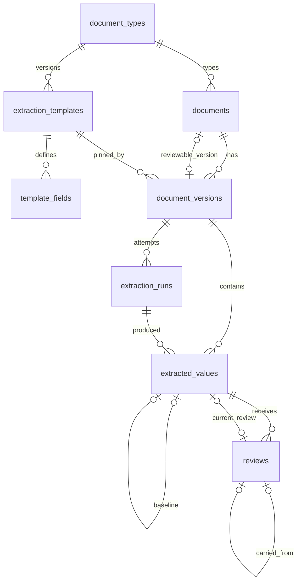

# Lomi Labs Take-Home — Engineering Plan v2

> Supersedes PLAN-v1. Adds:
> - document types and versioned extraction templates
> - the `reviewable_version_id` split
> - the final DB design and the full REST contract, from a five-specialist debate (Postgres
>   modeler, distributed-systems architect, REST designer, frontend developer, NestJS+Drizzle
>   implementer) with owner calls
> - request idempotency
> - observability
>
> Sections not repeated here (fixture analysis, core algorithms) carry over from PLAN-v1 unless
> this doc changes them.
>
> Deadline: **Sat 28 Nov 2026 23:59 UTC**.

---

## 1. Decision log

### Carried from v1 (unchanged)
| # | Decision |
|---|---|
| D1 | The version row `status='queued'` is the outbox. A reconciler sweep in the worker re-enqueues work (no outbox table). |
| D2 | A new version is accepted while the previous one is extracting. Extractions run concurrently; finalize and carry-over are serialized per document. |
| D4 | Carry a review iff the baseline has a current review, the values are equal, and the baseline's canonical evidence line(s) occur in the new normalized text. |
| D5–D6 | Normalization is NFC plus whitespace collapse only. A value not supported by its evidence becomes a gap. |
| D7–D10 | Corrections are annotations. Reviews are append-only with a current-review projection. Gaps are reviewable but never carry over. Progress buckets are disjoint. |
| D11–D13 | Claim / lease 30s / heartbeat 10s / sweep 10s, with `active_run_id` as the fencing token. Attempts are capped at 5. BullMQ retries transient errors in-run. `jobId = versionId`, with `removeOnComplete` and `removeOnFail`. |
| D14–D15 | S3 API (SeaweedFS in compose, AWS Emulator in CI). Content-addressed keys; the object is PUT before the DB tx. Parsed text is stored in Postgres. |
| D16–D17 | Provider-agnostic `LlmProvider` (Anthropic Sonnet 5.5 default, plus a fake). A missing key produces `failed LLM_NOT_CONFIGURED`. |
| D18–D29 | NestJS 11 (Express) for api and worker; Drizzle with generated migrations only; zod contracts; Vite SPA behind nginx; polling; unpdf; compiled packages; ESLint + Prettier; Node 24 slim; Vitest with real services; seed inserts `queued` only; deploy cut. |

### New in v2
| # | Decision | Chosen | Rejected |
|---|---|---|---|
| D30 | Field definitions | DB tables `document_types` → immutable versioned `extraction_templates` (content hash) → `template_fields`, seeded from `fixtures/expected-fields.json`. Each version pins `template_id`. A read-only `GET /document-types`; no management API | A TS constant, which can't evolve. A mutable per-type list, which rewrites history. |
| D31 | "Current version" | `currentVersion` / `status` = **latest uploaded** (the brief's meaning). `documents.reviewable_version_id` = latest extracted. The API exposes it as `valuesVersion` | One overloaded `current_version_id`. |
| D32 | Value storage | **jsonb + per-type shape CHECK** (decimal strings must be in canonical form, enforced by regex), so jsonb equality is exact | Typed `v_*` columns, which duplicate across values and reviews. |
| D33 | Composite FKs | Composite FKs on the two pointers: `documents(id, reviewable_version_id) → versions(document_id, id)` and `values(id, current_review_id) → reviews(value_id, id)`. Also `reviews(value_id, field_type) → values(id, field_type)`, required by the correction shape CHECK. If drizzle-kit can't emit one, downgrade it to a plain FK; never hand-edit | Composite FKs everywhere (ceremony), or no FKs. |
| D34 | Labels / display | Join `template_fields` (immutable and pinned). There is no stored display string. One `formatTypedValue()` in `contracts`, used by web | Snapshotting labels and display strings. |
| D35 | Request idempotency | **`Idempotency-Key` header with an `idempotency_keys` table**, written in the same tx as the resource. Also natural guards: re-uploading bytes identical to the latest version returns 200, and an identical review returns 200 no-op | No key table (it leaves the double-submitted `POST /documents` gap). |
| D36 | Review concurrency | Optional `expectedCurrentReviewId` → 409 `REVIEW_CONFLICT`; when absent, last write wins | `If-Match` on the document ETag, which is too coarse. |
| D37 | Polling cache | **Express built-in weak ETag** with `If-None-Match` → 304, plus `Cache-Control: no-cache` | A `documents.revision` counter: the worker's claim would have to lock the documents row. |
| D38 | Path prefix | None. The brief's paths are served verbatim at the API root; nginx strips `/api` | `/api/v1`, which would 404 a curl to the brief's paths. |
| D39 | Errors | RFC 9457 `application/problem+json` with `code` and `requestId` extension members (`type` = `about:blank`) | `{error:{…}}`; type URIs. |
| D40 | List pagination | **Keyset cursor** on `(created_at DESC, id DESC)`, with filters `type`, `status`, `needsReview` | Offset pagination; no pagination. |
| D41 | Review response | `{value: ValueView, progress}`: 201 when a review was appended, 200 on a no-op or replay | Bare `{value}`, which would force a progress refetch. |
| D42 | Detail reads | `REPEATABLE READ READ ONLY` tx for multi-query reads (detail, version detail, progress, list page) | Mixed-snapshot reads. |
| D43 | Ordering | The server sorts values by `attention` (changed → gap → pending → done, then position). The banner is derived client-side from `currentVersion.number ≠ valuesVersion` | Banner text from the server. |
| D44 | Health | `/health/live` always returns 200. `/health/ready` returns 503 only if Postgres is down; Redis or S3 down → 200 `degraded` | Treating Redis down as unhealthy (it is not the system of record). |
| D45 | Observability | `nestjs-pino` structured logs; **`X-Request-Id`** accepted or generated and propagated into job data, run rows and every log line; Prometheus `/metrics` on api and worker. OpenTelemetry tracing is in the cut list | Ad-hoc `console.log`; no correlation. |

### New in v2.1: pagination, soft delete, spike results
| # | Decision | Chosen | Rejected |
|---|---|---|---|
| D46 | Primary keys | **`uuid DEFAULT uuidv7()`** (native in PG18) on every surrogate-key table. Time-ordered, unique and immutable, so it serves as a single-column keyset | `(created_at, id)` tuples: a JS `Date` drops PG's microseconds, so rows that share a millisecond are skipped or duplicated. |
| D47 | Pagination style | **Keyset only, on immutable unique keys.** No offset. Attention is a **filter**, never a sort | Offset (O(n) and drifts on insert). Sorting by mutable columns (rows jump between pages). |
| D48 | Page contract | `{data, page:{limit, hasMore, nextCursor, prevCursor}}` **plus** RFC 8288 `Link: rel="next"/"prev"`. `limit` 1–100 (default 20; out of range → 400, never clamped). `hasMore` comes from fetching `limit+1` rows | Link header only (the SPA would have to parse headers). |
| D49 | Cursor | **Opaque base64url JSON `{v,k,d,f}`, unsigned**, validated with zod. `f` = fingerprint of the normalized filters and sort; a mismatch → 400 `CURSOR_MISMATCH` | HMAC signing: with no auth and parameterized SQL it buys nothing. |
| D50 | Totals | **None.** Only `hasMore` and cursors | Exact, estimated, capped or facet counts. |
| D51 | Embedded arrays | `detail.values` stays embedded (bounded: CHECK `position <= 100` on template fields), and is also available as a sub-resource. `detail.versions` is replaced by `recentVersions` (latest 5) + `versionsCount` + a link | Embedding unbounded version history. |
| D52 | "Needs review" at scale | **`documents.pending_count`**, maintained only in the finalize and review txs through `applyPendingDelta()`, with an invariant test that recomputes it. Partial index for `?needsReview=true`. The **review tx now takes `FOR NO KEY UPDATE`** on the document (reviews of the same document serialize). Progress shown to users is still computed | Stored `latest_status`, which would make the worker's claim lock `documents`. A computed filter that can't be indexed. |
| D53 | Soft delete scope | **Documents only** (the aggregate root). Children stay hidden while their document is deleted, through a parent check; nothing is stamped on them. Versions, values, reviews and runs are never deletable | `deleted_at` on every table, which would race the worker and needs propagation. Archive tables. A status flag. Hard delete with an audit log. |
| D54 | Delete semantics | `DELETE` → 204 (repeat → 204). **Delete = fence revocation**: in one tx under `documents FOR UPDATE`, in-flight versions become `failed DOCUMENT_DELETED` and their runs are abandoned. `POST /restore` → 200 (already live → 200 no-op) and re-queues those versions | Letting extraction finish after the delete. 202 plus an async workflow. |
| D55 | Reads of a deleted document | **410 Gone** with `code: DOCUMENT_DELETED` and `deletedAt`, for the document **and every nested route**. Writes → 410 as well. Lists exclude it by default; trash is `?deleted=only` | 404, which can't tell "deleted" apart from "never existed". |
| D56 | `external_id` | **Full UNIQUE** (not partial), so the seed's `ON CONFLICT DO NOTHING` never resurrects a document that was deleted | A partial unique on live rows, which lets the seed re-create a deleted fixture. |
| D57 | Excluding deleted rows | `getAliveDocument(tx, id, lock)` plus an `alive` predicate in list queries; an ESLint ban on raw `documents` queries outside `packages/db`; a **route-table leak test** | `pgView` (duplicated mappings); RLS (overkill with no tenants). |
| D58 | Purge / S3 GC | **Cut** (README). The order is: DB purge first; then delete an object only if nothing references it and its `LastModified` is older than a grace period | — |
| D59 | Spike-verified Drizzle conventions | drizzle-kit 0.31.11 generated every composite and circular FK, partial index and CHECK with no hand edits, and they applied cleanly to PG 18.7. Rules that follow: regexes live in `String.raw` constants injected with `sql.raw()` (a plain `sql` template turns `\d` into `d`); money CHECK adds `jsonb_typeof(value->'amount')='string'` (otherwise a JSON number passes); keyset indexes must match the query's direction and nulls order (Drizzle `.desc()` emits NULLS LAST), so define `id` ASC and let Postgres scan backward, guarded by an `EXPLAIN` test | — |

---

## 2. Concurrency model (authoritative)

**Isolation:** READ COMMITTED for every write tx, using explicit row locks and conditional
UPDATEs. REPEATABLE READ READ ONLY for multi-statement reads.

**Global lock order** (no tx acquires out of order, and no tx upgrades a lock):
`idempotency_keys → documents → document_versions → extraction_runs → extracted_values → reviews`

| Tx | Locks / statements |
|---|---|
| Create document | INSERT `idempotency_keys` (if a key is given; a concurrent duplicate blocks on the PK until the first tx commits) → INSERT documents → allocate version → INSERT version |
| New version | idempotency key → `UPDATE documents SET latest_version_number+1 … RETURNING` (row lock) → content-dedupe check against the latest version → INSERT version |
| Claim | INSERT run (`running`) + `UPDATE versions … WHERE id=$v AND status='queued'` in **one tx**; 0 rows → rollback. The partial unique index enforces one running run per version. **No document lock** |
| Heartbeat | `UPDATE versions SET lease_until=… WHERE id=$v AND active_run_id=$me` |
| Finalize | `documents FOR UPDATE` → if deleted, abort (a deleted document's run was already revoked) → `versions FOR UPDATE` (fence check) → INSERT values `ON CONFLICT DO NOTHING` → read baseline and its current reviews → INSERT carried reviews → UPDATE values `current_review_id` → version `extracted` → run `succeeded` → `reviewable_version_id = me` iff my number > the current reviewable number → `pending_count` = the pending values of the new reviewable version (set, not delta, when the pointer moves) |
| Fail | `UPDATE versions SET status='failed', active_run_id=NULL, lease_until=NULL, last_error_*… WHERE id=$v AND active_run_id=$me` + run `failed` |
| Review | idempotency key → `documents FOR NO KEY UPDATE` (D52) → alive check (410) → check `value.version_id = reviewable_version_id` → check `expectedCurrentReviewId` → no-op check → INSERT review → UPDATE `current_review_id` → `applyPendingDelta()` (−1 if the value was pending) |
| Delete | `documents FOR UPDATE` → `UPDATE documents SET deleted_at=now(), deleted_reason=… WHERE id AND deleted_at IS NULL` (0 rows → already deleted → 204) → in-flight versions `failed DOCUMENT_DELETED`, `active_run_id=NULL` → their runs `abandoned`. Worker fences then reject any late write |
| Restore | `documents FOR UPDATE` → `deleted_at=NULL WHERE deleted_at IS NOT NULL` → `DOCUMENT_DELETED` versions → `queued`; enqueue after commit |
| Retry | idempotency key (optional) → `UPDATE versions SET status='queued', attempts=0, last_error_*=NULL WHERE … AND status='failed'` |
| Sweep | `document_versions` / runs only, as single conditional statements. Never locks documents |

Outside every tx: the S3 PUT (before), `queue.add` (after commit, 500 ms timeout,
`enableOfflineQueue:false`), and the LLM call (never inside a tx).

---

## 3. Database schema

Conventions:
- Drizzle, with `drizzle-kit generate` only.
- Statuses are `text` + CHECK. No pgEnum, no triggers, no functions.
- `uuid` PKs use `defaultRandom()`. Timestamps are `timestamptz` with `defaultNow()`, and
  `updated_at` uses `$onUpdate`.
- FKs are `ON DELETE RESTRICT`.
- CHECK and status value lists come from the `contracts` tuples through one helper
  (`inList(col, values)`), so the DB and the API share a single source.

### 3.1 `document_types`
| column | type | rules |
|---|---|---|
| key | text PK | CHECK `key ~ '^[a-z][a-z0-9_]{1,40}$'` |
| display_name | text NOT NULL | |
| created_at | timestamptz NOT NULL | |

### 3.2 `extraction_templates` (immutable)
| column | type | rules |
|---|---|---|
| id | uuid PK | |
| document_type | text NOT NULL FK → document_types.key | |
| version | int NOT NULL | CHECK ≥ 1; UNIQUE(document_type, version) |
| content_sha256 | text NOT NULL | CHECK hex64; UNIQUE(document_type, content_sha256), the seed's idempotency key |
| created_at | timestamptz NOT NULL | |

"Latest template" for a type means `ORDER BY version DESC LIMIT 1`. There is no pointer column.

### 3.3 `template_fields`
| column | type | rules |
|---|---|---|
| template_id | uuid FK → extraction_templates | PK(template_id, field_key) |
| field_key | text NOT NULL | CHECK `~ '^[a-z][a-z0-9_]{0,62}$'` |
| field_type | text NOT NULL | CHECK in (`string`,`date`,`money`,`number`,`percent`) |
| position | int NOT NULL | CHECK `position BETWEEN 1 AND 100` (bounds the embedded values array, D51); UNIQUE(template_id, position) |
| label | text NOT NULL | derived from the key at seed ("Total amount") |
| description | text NULL | optional prompt hint |

> **PK convention (D46):** every `id uuid PK` below is `DEFAULT uuidv7()`.

### 3.4 `documents`
| column | type | rules |
|---|---|---|
| id | uuid PK | uuidv7 |
| external_id | text NULL | **full UNIQUE** (D56; NULLs allowed multiply) |
| pending_count | int NOT NULL default 0 | CHECK ≥ 0. Pending values of the reviewable version, used as an index key only (D52) |
| deleted_at | timestamptz NULL | soft delete (D53) |
| deleted_reason | text NULL | CHECK `deleted_reason IS NULL OR deleted_at IS NOT NULL`, length ≤ 500 |
| deleted_request_id | text NULL | correlation; CHECK `deleted_request_id IS NULL OR deleted_at IS NOT NULL` |
| type | text NOT NULL FK → document_types.key | |
| title | text NOT NULL | CHECK length 1–200 |
| latest_version_number | int NOT NULL default 0 | CHECK ≥ 0; allocation counter |
| reviewable_version_id | uuid NULL | **composite FK (id, reviewable_version_id) → document_versions(document_id, id)** |
| created_at, updated_at | timestamptz NOT NULL | |

Indexes (all keyset indexes on `id` ASC; Postgres scans them backward for `ORDER BY id DESC`, see D59):
- `(id) WHERE deleted_at IS NULL`: live list
- `(type, id) WHERE deleted_at IS NULL`: `?type=`
- `(id) WHERE deleted_at IS NULL AND pending_count > 0`: `?needsReview=true`
- `(type, id) WHERE deleted_at IS NULL AND pending_count > 0`: `?type=&needsReview=true`
- `(deleted_at, id) WHERE deleted_at IS NOT NULL`: trash (`?deleted=only`, newest deleted first)

`?status=` (latest version's status) is a **best-effort** filter: it joins
`document_versions` on `(document_id, version_number = latest_version_number)`. It is
documented as not O(limit) for rare statuses at 10M+ rows (README: add a denormalized status
plus an outbox-free update if needed).

### 3.5 `document_versions`
| column | type | rules |
|---|---|---|
| id | uuid PK | also the BullMQ jobId |
| document_id | uuid NOT NULL FK | UNIQUE(document_id, version_number); UNIQUE(document_id, id), the FK target |
| version_number | int NOT NULL | CHECK ≥ 1 |
| template_id | uuid NOT NULL FK → extraction_templates | pinned at upload |
| status | text NOT NULL default `queued` | CHECK in (`queued`,`extracting`,`extracted`,`failed`) |
| storage_key | text NOT NULL | `pdfs/sha256/<hex>.pdf` |
| file_sha256 | text NOT NULL | CHECK hex64 |
| file_size_bytes | int NOT NULL | CHECK `> 0 AND <= 10485760` |
| original_filename | text NOT NULL | |
| parsed_text | text NULL | |
| parsed_text_sha256 | text NULL | CHECK `(parsed_text IS NULL) = (parsed_text_sha256 IS NULL)` |
| parser | text NULL | e.g. `unpdf@x.y.z` |
| attempts | int NOT NULL default 0 | CHECK ≥ 0 |
| active_run_id | uuid NULL FK → extraction_runs | fencing token |
| lease_until | timestamptz NULL | |
| worker_id | text NULL | |
| enqueued_at | timestamptz NULL | sweep grace window |
| last_error_code | text NULL | |
| last_error_message | text NULL | |
| extracted_at | timestamptz NULL | |
| created_request_id | text NULL | correlation: the request that uploaded it |
| created_at, updated_at | timestamptz NOT NULL | |

CHECKs:
- `(status='extracting') = (active_run_id IS NOT NULL AND lease_until IS NOT NULL AND worker_id IS NOT NULL)`
- `(status='failed') = (last_error_code IS NOT NULL)`
- `(status='extracted') = (extracted_at IS NOT NULL)`
- `status <> 'extracted' OR parsed_text IS NOT NULL`

Index: partial `(status, lease_until) WHERE status IN ('queued','extracting')` for the sweep.

### 3.6 `extraction_runs`
| column | type | rules |
|---|---|---|
| id | uuid PK | run id = fencing token |
| version_id | uuid NOT NULL FK | UNIQUE(version_id, attempt) |
| attempt | int NOT NULL | CHECK ≥ 1 |
| status | text NOT NULL | CHECK in (`running`,`succeeded`,`failed`,`abandoned`) |
| trigger | text NOT NULL | CHECK in (`upload`,`sweep`,`retry`,`redelivery`) |
| correlation_id | text NOT NULL | request id or `sweep-<uuid>` |
| worker_id | text NOT NULL | |
| provider, model, prompt_version | text NULL | |
| request | jsonb NULL | system and user prompt plus tool schema |
| raw_response | jsonb NULL | verbatim |
| input_tokens, output_tokens | int NULL | promoted for SQL cost reporting |
| usage | jsonb NULL | full provider usage object |
| cost_usd | numeric(12,6) NULL | |
| latency_ms | int NULL | |
| error_code, error_message | text NULL | |
| started_at | timestamptz NOT NULL | |
| finished_at | timestamptz NULL | CHECK `(status='running') = (finished_at IS NULL)` |

Index: **partial UNIQUE (version_id) WHERE status='running'**, the DB-level backstop for the claim.

### 3.7 `extracted_values`
| column | type | rules |
|---|---|---|
| id | uuid PK | UNIQUE(id, field_type), the FK target for reviews |
| version_id | uuid NOT NULL FK | **UNIQUE(version_id, field_key)**, the idempotency backstop |
| run_id | uuid NOT NULL FK → extraction_runs | provenance |
| field_key | text NOT NULL | |
| field_type | text NOT NULL | CHECK in the 5 types (copied from the pinned template) |
| kind | text NOT NULL | CHECK in (`value`,`gap`) |
| value | jsonb NULL | canonical typed value (§3.9) |
| raw_value | text NULL | the LLM's literal string (audit) |
| evidence | text NULL | the LLM's quote |
| canonical_evidence | text NULL | normalized full line(s) |
| evidence_start, evidence_end | int NULL | CHECK `evidence_start <= evidence_end` |
| evidence_match_count | int NULL | CHECK ≥ 1 |
| gap_code | text NULL | CHECK in (`NOT_FOUND`,`MODEL_OMITTED`,`EVIDENCE_NOT_IN_TEXT`,`VALUE_NOT_SUPPORTED`,`UNPARSEABLE_VALUE`) |
| gap_reason | text NULL | |
| baseline_value_id | uuid NULL FK → extracted_values | |
| change_kind | text NOT NULL | CHECK in (`new`,`same`,`changed`); CHECK `(change_kind='new') = (baseline_value_id IS NULL)` |
| current_review_id | uuid NULL | **composite FK (id, current_review_id) → reviews(value_id, id)** |
| created_at | timestamptz NOT NULL | |

CHECK, gap invariant plus value shape:
```
(kind='gap'   AND value IS NULL AND evidence IS NULL AND canonical_evidence IS NULL
              AND gap_code IS NOT NULL AND gap_reason IS NOT NULL)
OR
(kind='value' AND gap_code IS NULL AND gap_reason IS NULL
              AND evidence IS NOT NULL AND canonical_evidence IS NOT NULL
              AND <VALUE_SHAPE(field_type, value)>)
```

### 3.8 `reviews` (append-only)
| column | type | rules |
|---|---|---|
| id | uuid PK | UNIQUE(value_id, id), the pointer FK target |
| value_id | uuid NOT NULL | composite FK (value_id, field_type) → extracted_values(id, field_type) |
| field_type | text NOT NULL | snapshot, FK-enforced; needed by the shape CHECK |
| decision | text NOT NULL | CHECK in (`approve`,`correct`) |
| corrected_value | jsonb NULL | CHECK `(decision='correct') = (corrected_value IS NOT NULL)` AND (`corrected_value IS NULL OR <VALUE_SHAPE(field_type, corrected_value)>`) |
| note | text NULL | CHECK length ≤ 1000 |
| origin | text NOT NULL | CHECK in (`human`,`carried`) |
| carried_from_review_id | uuid NULL FK → reviews | CHECK `(origin='carried') = (carried_from_review_id IS NOT NULL)` |
| request_id | text NULL | correlation |
| created_at | timestamptz NOT NULL | |

Index: `(value_id, created_at DESC)`. Append-only is enforced by the repository API (no
update or delete functions) plus a test.

### 3.9 Canonical typed values and `VALUE_SHAPE`
One helper in `packages/db` emits this SQL for both tables. The same rules exist as zod in
`contracts`.

| field_type | jsonb | shape rule |
|---|---|---|
| string | `"MERIDIAN OFFICE SUPPLIES LLC"` | `jsonb_typeof(v)='string' AND length(v#>>'{}') BETWEEN 1 AND 2000` |
| date | `"2025-03-01"` | `jsonb_typeof(v)='string' AND v#>>'{}' ~ '^\d{4}-(0[1-9]\|1[0-2])-(0[1-9]\|[12]\d\|3[01])$'` (calendar validity is checked in zod) |
| money | `{"amount":"5230.29","currency":"USD"}` | `jsonb_typeof(v)='object' AND (v - 'amount' - 'currency') = '{}'::jsonb AND jsonb_typeof(v->'amount')='string' AND jsonb_typeof(v->'currency')='string' AND v->>'amount' ~ DEC AND v->>'currency' ~ '^[A-Z]{3}$'` (without the `jsonb_typeof` on `amount`, a JSON number passes, as the spike showed) |
| number | `"24"` | `jsonb_typeof(v)='string' AND v#>>'{}' ~ DEC` |
| percent | `"4.2"` (percent units) | `jsonb_typeof(v)='string' AND v#>>'{}' ~ DEC` |

All regexes are `String.raw` constants injected with `sql.raw()` (D59).
`DEC = '^-?(0|[1-9][0-9]*)(\.[0-9]*[1-9])?$'` is a **canonical decimal**: no leading zeros, no
trailing fractional zeros, no `+`. `core.canonicalDecimal()` produces it ("5230.10" → "5230.1",
"024" → "24"), and the DB rejects anything else. That makes jsonb `=` / deep-equal exact for
carry-over. The UI's formatter pads money to 2 dp for display.

### 3.10 `idempotency_keys`
| column | type | rules |
|---|---|---|
| scope | text NOT NULL | CHECK in (`create_document`,`create_version`,`review`,`retry`) |
| key | text NOT NULL | CHECK `~ '^[A-Za-z0-9_-]{8,128}$'`; PK(scope, key) |
| request_sha256 | text NOT NULL | hash of the canonical request (see §5.3) |
| response_status | int NOT NULL | 200/201/202 |
| resource_type | text NOT NULL | CHECK in (`document`,`version`,`review`) |
| resource_id | uuid NOT NULL | |
| request_id | text NULL | |
| created_at | timestamptz NOT NULL | |
| expires_at | timestamptz NOT NULL | created_at + 24h |

Index: `(expires_at)`. The sweep deletes expired keys in batches (`DELETE … WHERE expires_at < now()`).



**Spike: done (D59).** drizzle-kit 0.31.11 / drizzle-orm 0.45.4 generated all three
composite FKs (circular ones emitted as trailing `ALTER TABLE … ADD CONSTRAINT`), the
partial unique and partial indexes, and every CHECK including `VALUE_SHAPE`. The migration
applied cleanly to Postgres 18.7. Insert tests rejected:
- non-canonical decimals
- `2025-13-01`
- an extra key in a money object
- a gap row that carries a value
- a cross-document pointer
- a second running run for the same version

Re-running `generate` produced no spurious diff, and `drizzle-kit check` passed. Remaining
to verify at scaffold: `uuidv7()` defaults. CI runs `drizzle-kit generate` followed by
`git diff --exit-code packages/db/drizzle`.

### 3.11 Seed (migrate container, idempotent)
1. Run migrations.
2. Ensure the S3 bucket exists (`CreateBucket`; `BucketAlreadyOwnedByYou` or a 200 count as success).
3. Load `expected-fields.json`:
   1. Upsert each `document_types` row.
   2. Canonicalize and hash each field list.
   3. `INSERT extraction_templates … ON CONFLICT (document_type, content_sha256) DO NOTHING` with version = max+1, then insert its fields.
4. For each manifest document: PUT v1's PDF and upsert the document on `external_id`. If it has
   no versions, insert v1 as `queued`, pinned to the latest template.
5. The worker's boot sweep enqueues it.

---

## 4. REST API

### 4.1 Conventions
- **Paths:** the brief's paths verbatim, at the API root. nginx serves the SPA and proxies
  `/api/*` → `api:3000/*`.
- **JSON:** camelCase. Timestamps are ISO-8601 UTC. IDs are UUIDs. Versions are addressed by
  number under their document.
- **Contracts:** zod schemas in `packages/contracts`, used for DTOs (`nestjs-zod`), response
  validation in tests, and Swagger at `GET /docs`.
- **Request headers:**
  - `X-Request-Id`: optional, `^[A-Za-z0-9._-]{1,128}$`. Generated (uuid) if absent or invalid.
  - `Idempotency-Key`: optional on the 4 mutating POSTs. The web app always sends one per user action.
  - `If-None-Match`: on GETs.
- **Response headers:**
  - `X-Request-Id`: always.
  - `ETag`: weak, from Express.
  - `Cache-Control: no-cache` on GETs.
  - `Location` on 201.
  - `Idempotent-Replayed: true` on replay.
  - `Retry-After: 5` on 503.
- **Typed value (`TypedValue`)**, per `fieldType`:
  - `string`: string
  - `date`: `"YYYY-MM-DD"`
  - `money`: `{amount: DecimalString, currency: "USD"}`
  - `number` and `percent`: DecimalString
  - JSON numbers are rejected for numeric types (no floats).
  - Input decimals may be non-canonical ("5230.10"). The server canonicalizes them, and
    responses are always canonical.

### 4.1a Pagination contract (every collection)
**Query parameters:**
- `limit`: int 1–100, default 20. Out of range → 400 `INVALID_LIMIT`.
- `cursor`: opaque. When a cursor is present, filters and `sort` must be omitted or identical;
  otherwise 400 `CURSOR_MISMATCH`.
- `sort`: from a per-collection whitelist of **immutable, unique, index-backed keys only**.
  An unknown value → 400 `INVALID_SORT`.
- Filters: flat `field=value` pairs from a per-collection whitelist. An unknown filter → 400
  `INVALID_FILTER`.

**Response:**
```json
200 OK
Link: </documents?limit=20&cursor=eyJ2Ij…>; rel="next", </documents?limit=20&cursor=eyJ2Ijo…>; rel="prev"

{ "data": [ … ],
  "page": { "limit": 20, "hasMore": true, "nextCursor": "eyJ2Ij…", "prevCursor": null } }
```

**Cursor:** base64url(JSON) `{v:1, k:<last key value(s)>, d:"next"|"prev", f:<sha256(normalized filters+sort)[:16]>}`.
- Validated with zod; a bad cursor → 400 `INVALID_CURSOR`. Not signed (D49).
- Key values are encoded as strings, never passed through a JS `Date`.

**SQL shape:** `WHERE <filters> AND key < $k ORDER BY key DESC LIMIT $limit+1`. For `prev`,
flip the comparison and the order, then reverse in memory. `hasMore` comes from the extra row.
There are no totals (D50).

**Consistency guarantee (documented):** a row that is live and matches the filters for the
whole traversal appears exactly once. Rows inserted mid-traversal may be missed. Rows deleted
mid-traversal disappear without shifting other rows. Each page is read in one REPEATABLE READ
READ ONLY tx and carries a weak ETag (polling page 1 → 304).

**Contracts:**
```ts
PageMeta = z.object({ limit: z.number().int(), hasMore: z.boolean(),
                      nextCursor: z.string().nullable(), prevCursor: z.string().nullable() })
Page = <T extends z.ZodTypeAny>(item: T) => z.object({ data: z.array(item), page: PageMeta })
listQuery = (sorts, filters) => z.object({ limit: z.coerce.number().int().min(1).max(100).default(20),
              cursor: z.string().max(512).optional(), sort: z.enum(sorts).optional(), ...filters })
```
**Implementation:**
- `packages/db`:
  - `keyset({key, dir, cursor, limit})` → `{where, orderBy, limit}` fragments
  - `toPage(rows, limit, keyFn)`
- Nest: a `@Paginated()` decorator plus an interceptor that emits `Link` from `page` and the
  request URL.
- OpenAPI: shared `PageMeta` and `Link` header components.

**Collections:**
| Collection | Key / default sort | Sort whitelist | Filters |
|---|---|---|---|
| `GET /documents` | `id` (uuidv7) DESC | `-id`, `id` | `type`, `needsReview` (indexed), `status` (best-effort), `externalId`, `deleted=exclude\|include\|only` (default `exclude`; `only` sorts by `-deletedAt`) |
| `GET /document-types` | `key` ASC | `key` | — |
| `GET /documents/:id/versions` | `version_number` DESC | `-number`, `number` | `status` |
| `GET /documents/:id/versions/:n/values` | `position` ASC | `position` | `reviewState`, `attention` (bounded set, filtered in memory) |
| `GET /values/:id/reviews` | `id` (uuidv7) DESC | `-id` | `origin` |
| `GET /documents/:id/versions/:n/runs` | `attempt` DESC | `-attempt` | `status` |

**Embedded arrays:**
- `DocumentDetail.values` is the full bounded set (≤ 100, sorted by attention).
- `DocumentDetail.recentVersions` holds the latest 5 `VersionSummary`, plus `versionsCount`
  (= `latest_version_number`) and `links.versions`.

### 4.2 Error format (RFC 9457)
```json
HTTP/1.1 409 Conflict
Content-Type: application/problem+json

{ "type": "about:blank", "title": "Version not reviewable", "status": 409,
  "code": "VERSION_NOT_REVIEWABLE",
  "detail": "Value belongs to v1; v2 is the reviewable version.",
  "instance": "/values/5c1…/review", "requestId": "b7e4…",
  "errors": [ { "path": "correctedValue.amount", "message": "Expected decimal string" } ] }
```
`errors[]` appears only on 400 and 422. `code` is a stable enum the UI switches on.

**Error codes:**
- 400: `VALIDATION_FAILED`, `INVALID_CURSOR`, `CURSOR_MISMATCH`, `INVALID_LIMIT`, `INVALID_SORT`, `INVALID_FILTER`, `INVALID_ID`
- 410: `DOCUMENT_DELETED` (the document and every nested route, for reads and writes; the body includes `deletedAt`)
- 404: `DOCUMENT_NOT_FOUND`, `VERSION_NOT_FOUND`, `VALUE_NOT_FOUND`, `RUN_NOT_FOUND`
- 409:
  - `VERSION_NOT_REVIEWABLE`, `REVIEW_CONFLICT`
  - `NOT_RETRYABLE`, `TEXT_NOT_AVAILABLE`
  - `IDEMPOTENCY_KEY_IN_USE` (a concurrent duplicate whose first request is still running; see §5.3)
- 413: `FILE_TOO_LARGE`
- 415: `UNSUPPORTED_MEDIA_TYPE`
- 422: `UNKNOWN_DOCUMENT_TYPE`, `NO_TEMPLATE_FOR_TYPE`, `INVALID_CORRECTION`, `IDEMPOTENCY_KEY_REUSED`
- 500: `INTERNAL`
- 503: `STORAGE_UNAVAILABLE`, `DATABASE_UNAVAILABLE`

DB constraint violations (`23505`, `23514`) that escape are mapped to 500 `INTERNAL` and logged
at `error` with the constraint name. Such a violation means a bug.

### 4.3 Shared schemas
```ts
DocumentType  = 'invoice' | 'lease' | 'market_report' | string   // validated against DB
VersionStatus = 'queued' | 'extracting' | 'extracted' | 'failed'
ReviewState   = 'pending' | 'approved' | 'corrected' | 'carried_over'
Attention     = 'changed' | 'gap' | 'pending' | 'done'
Progress      = { versionNumber: number|null, pending, approved, corrected, carriedOver, total: number, gaps: number }
VersionError  = { code: string, message: string, retryable: boolean }

VersionSummary = {
  number, status: VersionStatus, templateVersion: number,
  error: VersionError|null, attempts: number,
  createdAt, extractedAt: string|null, reviewable: boolean
}

Review = {
  id, decision: 'approve'|'correct', correctedValue: TypedValue|null, note: string|null,
  origin: 'human'|'carried', carriedFromVersion: number|null, createdAt
}

Evidence = { quote: string, line: string, start: number, end: number, matchCount: number }

ValueView = {
  id, fieldKey, label, fieldType, position,
  kind: 'value'|'gap',
  value: TypedValue|null,               // as extracted; null for gaps
  effectiveValue: TypedValue|null,      // correctedValue ?? value
  evidence: Evidence|null,
  gap: { code, reason }|null,
  changeKind: 'new'|'same'|'changed',
  reviewState: ReviewState,
  attention: Attention,
  review: Review|null,                  // current review (carried info inside)
  previous: {                           // baseline in the prior extracted version; null if changeKind='new'
    versionNumber, valueId, kind, value, effectiveValue,
    evidence: { quote, line }|null, gap: { code, reason }|null, review: Review|null
  }|null,
  reviewable: boolean
}

DocumentSummary = {
  id, externalId: string|null, type, typeLabel, title,
  status: VersionStatus,                // = currentVersion.status (brief)
  currentVersion: VersionSummary,       // latest uploaded
  valuesVersion: number|null,           // reviewable (latest extracted)
  progress: Progress, needsReview: boolean, createdAt
}

DocumentDetail = DocumentSummary & {
  values: ValueView[],                  // bounded by template (≤100)
  recentVersions: VersionSummary[],     // latest 5
  versionsCount: number,
  links: { versions: string }           // → paginated GET /documents/:id/versions
}
// DocumentSummary also gains: deletedAt: string|null (non-null only under ?deleted=include|only)
```
`values` are sorted by `attention` (changed → gap → pending → done), then by `position`.
`attention` = `changed` if changeKind=changed and pending; `gap` if kind=gap and pending;
`pending` if pending; otherwise `done`.

### 4.4 Endpoints

#### `GET /document-types`
- **200** `{ data: [{ key, displayName, template: { version, fields: [{ key, label, type, position, description }] } }] }` (latest template per type).

#### `POST /documents`: upload a PDF (brief)
- **Request:** `multipart/form-data`
  - `file`: required, exactly one, ≤ 10 MB, first bytes `%PDF-`
  - `type`: required, must exist in `document_types` and have a template
  - `title`: optional, trimmed, 1–200 chars; defaults to the filename stem
  - headers: `Idempotency-Key?`
- **Validation order:**
  1. multipart parse
  2. presence → 400
  3. size → 413
  4. magic bytes → 415
  5. `type` exists → 422 `UNKNOWN_DOCUMENT_TYPE`
  6. template exists → 422
  7. idempotency replay check (§5.3)
  8. S3 PUT → 503
  9. tx
- **201** `DocumentDetail` (currentVersion v1 `queued`, `values: []`, `valuesVersion: null`), `Location: /documents/:id`.
  This is returned even if the enqueue failed; the sweep repairs it.
- **200** replay (`Idempotent-Replayed: true`), returning the current state.
- **Errors:** 400, 413, 415, 422, 409 `IDEMPOTENCY_KEY_IN_USE`, 422 `IDEMPOTENCY_KEY_REUSED`, 503.

#### `POST /documents/:id/versions`: upload a new version (brief)
- **Request:** multipart `file` (same rules), `Idempotency-Key?`. A `type` field is rejected (400): type is immutable.
- **Behaviour:**
  - Allowed in any state, including while the previous version is extracting.
  - **Content dedupe:** bytes identical to the **latest** version → **200** with that version and `deduplicated: true`; no new version.
  - Identical bytes to an *older* version → a new version, which legitimately reverts and carries everything.
- **201** `{ document: DocumentSummary, version: VersionSummary }`, `Location: /documents/:id/versions/:n`.
- **Errors:** 400, 404, 413, 415, 409/422 (idempotency), 503.

#### `GET /documents`: list
- **Query:** the pagination contract (§4.1a), with filters `type`, `needsReview`, `status`, `externalId`, `deleted`.
- **Order:** `id` DESC (newest first; uuidv7). Within a page, the UI groups by attention. The
  "Needs review" tab uses `?needsReview=true`.
- **200** `Page<DocumentSummary>` plus a `Link` header.
- **Errors:** 400 (`INVALID_CURSOR`, `CURSOR_MISMATCH`, `INVALID_LIMIT`, `INVALID_SORT`, `INVALID_FILTER`).

#### `DELETE /documents/:id`: soft delete
- **Request:** optional JSON `{ reason?: string ≤ 500 }`.
- **204** No Content. A repeat on an already-deleted document → **204** (idempotent). A
  never-existing id → 404.
- **Effect (one tx):** sets `deleted_at`. In-flight versions → `failed DOCUMENT_DELETED`, and
  their runs → `abandoned` (fence revocation, D54). S3 objects are untouched.
- No `Idempotency-Key` needed, because the call is idempotent by definition (a key sent anyway
  is ignored).

#### `POST /documents/:id/restore`
- **200** `DocumentDetail`. A document that is not deleted → 200 (no-op). Never existed → 404.
- **Effect (one tx):** `deleted_at = NULL`. `DOCUMENT_DELETED` versions → `queued`, enqueued
  after commit.

#### Deleted documents
- Every route under `/documents/:id/**` and `/values/:id/**` that resolves to a deleted
  document → **410** `DOCUMENT_DELETED`, for both reads and writes. 410 takes precedence over
  409.
- Lists exclude deleted documents unless `?deleted=include|only` is set.
- An Idempotency-Key replay of the original create still returns its stored 201 response, and
  a follow-up GET → 410.

#### `GET /documents/:id`: detail (brief)
- **200** `DocumentDetail`, built in a single REPEATABLE READ READ ONLY tx. Supports a weak ETag, so a 2s poll costs a 304 when nothing changed.
- **Errors:** 400 `INVALID_ID`, 404.

#### `GET /documents/:id/versions/:n`: historical or any version
- **200** `VersionSummary & { values: ValueView[], progress: Progress, file: { filename, sizeBytes, sha256 } }`.
  `reviewable` is true only when n = valuesVersion.
- **Errors:** 400, 404 `VERSION_NOT_FOUND`.

#### `GET /documents/:id/versions/:n/text`
- **200** `text/plain; charset=utf-8`: the exact `parsed_text`, so offsets match. `Cache-Control: public, max-age=31536000, immutable`.
- **Errors:** 404, 409 `TEXT_NOT_AVAILABLE`.

#### `GET /documents/:id/versions/:n/file`
- **200** `application/pdf`, streamed from S3, with `Content-Disposition: inline; filename=…` and `ETag: "<sha256>"`.
- **Errors:** 404, 503.

#### `POST /documents/:id/versions/:n/retry`
- **Request:** empty body, `Idempotency-Key?`.
- **202** `VersionSummary` (`status: 'queued'`).
- **Errors:** 404, 409 `NOT_RETRYABLE` (with `details.status`).

#### `GET /documents/:id/versions/:n/runs` (debug)
- **200** `{ data: [{ id, attempt, status, trigger, correlationId, provider, model, promptVersion, inputTokens, outputTokens, costUsd, latencyMs, error, startedAt, finishedAt }] }`.

#### `GET /documents/:id/versions/:n/runs/:runId` (debug)
- **200** the run plus `request` and `rawResponse`.
- **Errors:** 404.

#### `GET /documents/:id/progress` (brief)
- **200** `Progress` for the reviewable version, or zeros with `versionNumber: null` before the first extraction. Uses a REPEATABLE READ tx.
- **Errors:** 404.

#### `POST /values/:id/review`: approve or correct (brief)
- **Request (JSON):** a discriminated union on `decision`.
  ```json
  { "decision": "approve", "note": "optional ≤1000", "expectedCurrentReviewId": "uuid|null (optional)" }
  { "decision": "correct", "correctedValue": <TypedValue>, "note": "…", "expectedCurrentReviewId": "…" }
  ```
- **Validation:**
  - `approve` with `correctedValue` present → 400.
  - `correct` without it → 400.
  - `correctedValue` is checked against the value's stored `fieldType`. Wrong shape, invalid date, a float, or an empty string → 422 `INVALID_CORRECTION`, with `errors[]` and an expected-format hint.
  - Approving a gap means "confirmed not present". Correcting a gap supplies a value.
- **Processing (one tx):**
  1. idempotency
  2. doc `FOR SHARE`
  3. reviewable check → 409 `VERSION_NOT_REVIEWABLE` (`details.reviewableVersion`)
  4. `expectedCurrentReviewId` mismatch → 409 `REVIEW_CONFLICT` (`details.currentReview`)
  5. identical to the current human review → 200 no-op
  6. insert and update the projection
- **201** `{ value: ValueView, progress: Progress }`, `Location: /values/:id/reviews/:reviewId`. **200** for a no-op or replay.
- **Errors:** 400, 404, 409, 422.

#### `GET /values/:id/reviews`: history (read-only)
- **200** `Page<Review>`, newest first (`id` DESC).
- **Errors:** 404, 410.

#### `GET /documents/:id/versions`: version history
- **200** `Page<VersionSummary>`, `version_number` DESC, with a `status` filter.
- **Errors:** 404, 410.

#### `GET /documents/:id/versions/:n/values`
- **200** `Page<ValueView>` in `position` order (bounded; normally one page). Filters
  `reviewState` and `attention`.
- **Errors:** 404, 410.

#### `GET /health/live`, `GET /health/ready`, `GET /metrics`, `GET /docs`
- `live`: always 200.
- `ready`: 200 `{status:'ok'|'degraded', checks:{db,redis,s3}}`, or 503 when the DB is down.
- `metrics`: Prometheus text.
- `docs`: Swagger UI.

### 4.5 Status code matrix
| Endpoint | 200 | 201 | 202 | 304 | 400 | 404 | 409 | 413 | 415 | 422 | 503 |
|---|---|---|---|---|---|---|---|---|---|---|---|
| POST /documents | replay | ✓ | | | ✓ | | key in use | ✓ | ✓ | type / key reused | ✓ |
| POST /documents/:id/versions | dedupe / replay | ✓ | | | ✓ | ✓ | key in use | ✓ | ✓ | key reused | ✓ |
| GET /documents | ✓ | | | ✓ | cursor | | | | | | |
| GET /documents/:id | ✓ | | | ✓ | id | ✓ | | | | | |
| GET …/versions/:n(/text\|/file\|/runs) | ✓ | | | ✓ | ✓ | ✓ | text n/a | | | | file |
| POST …/versions/:n/retry | replay | | ✓ | | | ✓ | not retryable | | | key reused | |
| GET /documents/:id/progress | ✓ | | | ✓ | | ✓ | | | | | |
| POST /values/:id/review | no-op / replay | ✓ | | | ✓ | ✓ | not reviewable / conflict / key in use | | | correction / key reused | |
| GET /values/:id/reviews | ✓ | | | ✓ | page params | ✓ | | | | | |
| DELETE /documents/:id | | | | | ✓ | ✓ | | | | | |
| POST /documents/:id/restore | ✓ | | | | | ✓ | | | | | |

Every list endpoint returns 200 `Page<T>` + `Link`, and 400 for page-parameter errors. Every
route under a deleted document returns **410**. DELETE returns **204** on success and on
repeat.

---

## 5. Cross-cutting

### 5.1 Validation layers
1. **Multer:** `FileInterceptor('file', { storage: memoryStorage(), limits: { fileSize: 10 MB, files: 1 } })`.
   `PdfFilePipe` checks presence and magic bytes. The client-provided mimetype is ignored.
2. **`ZodValidationPipe`** (global): params (uuid, positive int), query, and body, all from `contracts`.
3. **Domain service:** type and template exist; reviewable; correction by `fieldType` using
   `core.parseTypedValue`; idempotency.
4. **DB constraints:** the last line. A hit means a bug and is logged loudly.

### 5.2 Response mapping
Rows never leave the repository layer raw. A `toValueView()` / `toDocumentDetail()` mapper
computes `reviewState`, `effectiveValue`, `attention`, `previous` and `reviewable`. API e2e
tests parse every response with the `contracts` schema, so drift fails CI. Internal columns
(`active_run_id`, `lease_until`, `worker_id`, `storage_key`, version UUIDs) are never exposed.

### 5.3 Request idempotency (`Idempotency-Key`)
- **Scopes:** `create_document`, `create_version` (per document), `review` (per value), `retry`
  (per version). The key namespace is `(scope, key)`.
- **Request hash (sha256 over canonical JSON):**
  - create: `{type, title, fileSha256}`
  - version: `{documentId, fileSha256}`
  - review: `{valueId, decision, correctedValue(canonical), note}`
  - retry: `{documentId, versionNumber}`
- **Flow:** this runs in the **same tx** as the resource, as the **first** statement:
  `INSERT … ON CONFLICT (scope, key) DO NOTHING RETURNING`. Postgres makes a concurrent duplicate
  **block** on the PK until the first tx commits or rolls back.
  - **Inserted:** proceed, then fill in `response_status` and `resource_id` before commit.
  - **Conflict, same hash:** return the **current state** of the stored resource with the
    stored status code (as 200, with `Idempotent-Replayed: true`).
  - **Conflict, different hash:** 422 `IDEMPOTENCY_KEY_REUSED`.
  - **Conflict, row not visible yet** (the first tx is still mid-flight, which can only happen
    across the S3 PUT window): 409 `IDEMPOTENCY_KEY_IN_USE` with `Retry-After: 1`.
- **Expiry:** 24h. Expired keys are ignored and deleted by the sweep.
- **Upload ordering:** validate, then S3 PUT (content-addressed and idempotent), then the tx with
  the key insert. A replay never re-PUTs if the key already exists. That replay pre-check happens
  outside the tx before the PUT, as an optimization.
- **Layered with natural guards:** identical-bytes-to-latest dedupe (versions), identical-review
  no-op, retry only from `failed`, and the button disabled while a request is in flight.

### 5.4 Observability (NestJS)
- **Logging:** `nestjs-pino` (pino-http).
  - JSON in containers; `pino-pretty` when `LOG_FORMAT=pretty`.
  - `genReqId` takes a valid `X-Request-Id` or generates a UUID, and echoes it in the response header.
  - Every log line inside a request carries `requestId` (pino-http plus the ALS-backed
    `PinoLogger`; ALS is used for log context only, never for transactions).
  - Redaction: `req.headers.authorization`, `req.headers.cookie`, `*.apiKey`, `*.ANTHROPIC_API_KEY`.
    PDF bytes and parsed text are never logged; prompts and raw responses go to `extraction_runs`,
    not logs.
  - Log levels: `info` for state transitions (uploaded, claimed, extracted, failed, swept,
    carried=N); `warn` for enqueue failures, a fenced (zombie) write, or an expired lease;
    `error` for constraint violations and unexpected exceptions.
- **Correlation across processes:**
  - API → job data `{ versionId, requestId }`. The worker's processor creates a child logger
    with `{ requestId, documentId, versionId, runId, attempt, workerId, trigger }`.
  - Sweep-enqueued jobs get `correlationId = sweep-<uuid>` and `trigger = 'sweep'`.
  - Persistence: `document_versions.created_request_id`, `extraction_runs.correlation_id` and
    `trigger`, `reviews.request_id`, `idempotency_keys.request_id`. A requestId found in a
    problem+json body can be traced from the HTTP log to the run row to the worker logs.
- **Metrics:** `prom-client`, exposed at `/metrics` on api (:3000) and worker (:3001; the
  worker runs a minimal HTTP listener for health and metrics only).
  - `http_request_duration_seconds{method,route,status}` (histogram, api)
  - `documents_uploaded_total{type}`, `versions_deduplicated_total`, `idempotent_replays_total{scope}`
  - `extraction_runs_total{outcome=succeeded|failed|abandoned, error_code}`
  - `extraction_duration_seconds` and `llm_latency_seconds{provider,model}` (histograms)
  - `llm_tokens_total{direction=in|out,model}`, `llm_cost_usd_total{model}`
  - `sweep_requeued_total{reason=queued_lost|lease_expired|boot_release}`, `sweep_failed_max_attempts_total`
  - `fenced_writes_total` (zombie writes rejected)
  - `reviews_total{decision,origin}`, `carried_reviews_total`
  - `versions_by_status{status}`: a gauge refreshed by the sweep from the DB, not from Redis
- **Health:** Terminus checks DB, Redis and S3 indicators as in D44.
- **Cut line:** OpenTelemetry auto-instrumentation (http, express, pg, ioredis) plus an OTLP
  exporter. Documented in the README as the next step. A Grafana dashboard is out of scope.

---

## 6. Updates to other sections of v1
- **§4 core:**
  - Prompt and schema building takes the template fields (key, type, label, description) as input.
  - `canonicalDecimal()` and `parseTypedValue(fieldType, input)` are shared by evidence
    validation, corrections and carry-over equality.
- **§5 flows:**
  - The upload pins `template_id` to the latest template.
  - Finalize uses the version's pinned template.
  - Carry-over matches by `field_key`. A field missing from the baseline is `new`; a removed
    field is simply absent.
- **§7 UI:**
  - The upload dialog reads `GET /document-types`.
  - The detail view consumes `ValueView.attention`, `previous` and `reviewable`.
  - The banner is derived from `currentVersion.number !== valuesVersion` plus `currentVersion.status`.
  - Mutations send `Idempotency-Key` and `expectedCurrentReviewId`.
  - The list uses `?needsReview=true` as a filter chip and paginates with the cursor.
- **§8 layout:** add `apps/api/src/{document-types,observability}/`, `apps/worker/src/http/`
  (health + metrics), and `packages/db/src/sql/value-shape.ts` (the CHECK helper).
- **§10 tests, added:**
  - the template seed is idempotent and re-hashing an unchanged file is a no-op
  - an edited template creates v2, and a new version pins it
  - unknown type → 422
  - an Idempotency-Key replay returns the same resource; a reused key with a different body →
    422; concurrent duplicates → one resource
  - identical re-upload → 200 dedupe
  - an identical review is a no-op
  - stale `expectedCurrentReviewId` → 409
  - a VALUE_SHAPE CHECK rejects a non-canonical decimal (DB test)
  - the keyset cursor pages correctly across equal `created_at`
  - `X-Request-Id` is propagated into the run row and the problem+json body
  - `/metrics` exposes the extraction counters

## 6a. Tests added in v2.1
- **Pagination**, for every collection:
  - page boundaries with `limit+1`, `hasMore`
  - next and prev symmetry
  - a cursor reused with different filters → 400
  - an invalid limit or sort → 400
  - inserts and deletes during a traversal don't duplicate rows
  - an `EXPLAIN` for each list query uses its index (no Sort node)
- **Soft delete:**
  - the route-table leak test: delete, then every discovered route → 410 or excluded; restore,
    then 200 again
  - delete mid-extraction → a zombie finalize writes nothing, and restore re-queues and completes
  - repeated DELETE → 204
  - the seed doesn't resurrect a deleted fixture
  - `?deleted=only` lists it
- **`pending_count` invariant:** after every integration scenario, a recompute from source
  equals the stored value. Concurrent reviews on one document serialize correctly.

## 7. Budget delta
+1h idempotency, +1.5h observability, +0.5h templates, +0.5h cursor. v2.1 adds the generic
pagination across 6 collections (+3.5h, replacing the 0.5h cursor estimate), soft delete,
restore and the leak test (+3.5h), and `pending_count` (+1h). The total is now **~33h**.
That is more than the time left before the deadline, so the cut list below matters.

**Revised cut order:**
1. OTel tracing (already cut)
2. quote highlighting
3. keyboard shortcuts
4. run debug drawer
5. compose-smoke CI job
6. `scripts/eval.ts`
7. the metrics beyond the extraction/LLM/sweep core
8. shadcn polish

**Never cut:** fenced claim and finalize, sweep, carry-over plus its fixture test, evidence
validation, the review lock, the chaos test, request idempotency, request-id propagation.
